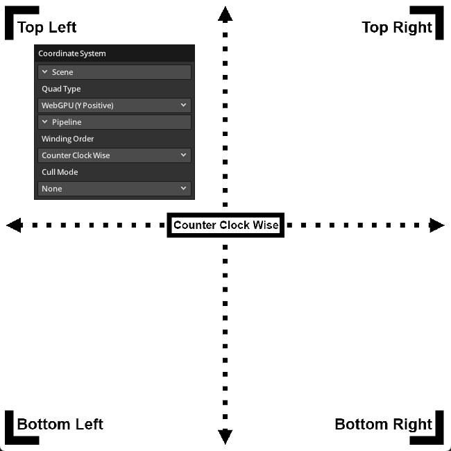

# Coordinate System

Illustrates the coordinate systems used in WebGPU. WebGPU's coordinate
systems match DirectX and Metal's coordinate systems in a graphics pipeline.
Y-axis is up in normalized device coordinate (NDC): point(-1.0, -1.0) in NDC
is located at the bottom-left corner of NDC. This example has several options
for changing relevant pipeline state, and displaying meshes with WebGPU or
Vulkan style coordinates.

Ref:

- https://github.com/samdauwe/webgpu-native-examples/blob/master/src/examples/coordinate_system.c
- https://gpuweb.github.io/gpuweb/
- https://github.com/gpuweb/gpuweb/issues/416
- https://github.com/SaschaWillems/Vulkan/blob/master/examples/negativeviewportheight/negativeviewportheight.cpp

## Running

```shell
build.bat|sh coordinate_system run
```

## Screenshot


