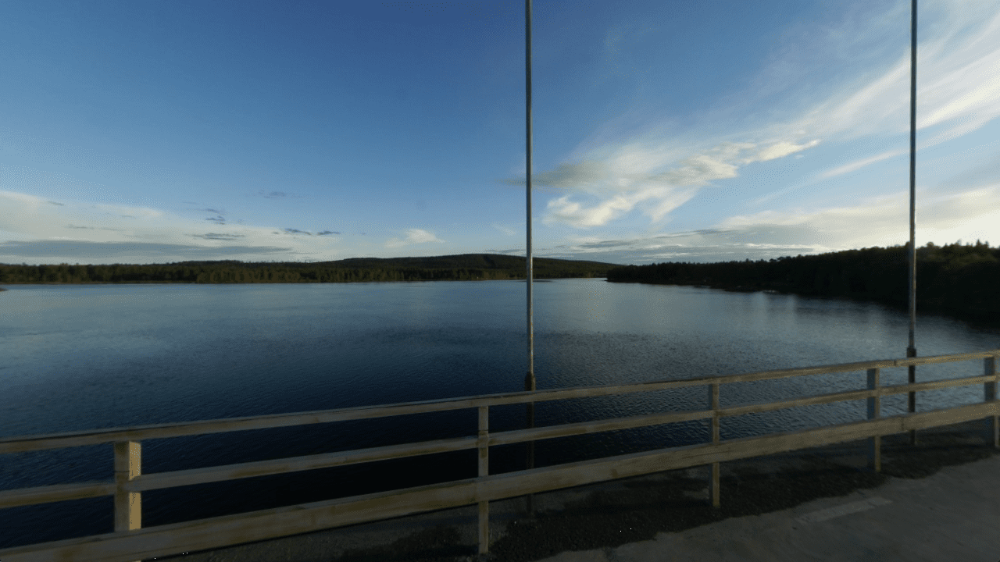

# Cubemap

This example shows how to render and sample from a cubemap texture.

The example uses a simplified approach: instead of rendering a cube geometry, it
draws a fullscreen triangle and uses the inverse view-projection matrix to
compute the cubemap sampling direction in the fragment shader.

This means:

- No vertex buffers needed
- No depth texture needed
- Only 3 vertices drawn instead of 36

Ref:

- https://github.com/samdauwe/webgpu-native-examples/blob/master/src/examples/cubemap.c
- https://github.com/webgpu/webgpu-samples/tree/main/sample/cubemap

## Running

```shell
build.bat|sh cubemap run
```

## Screenshot


