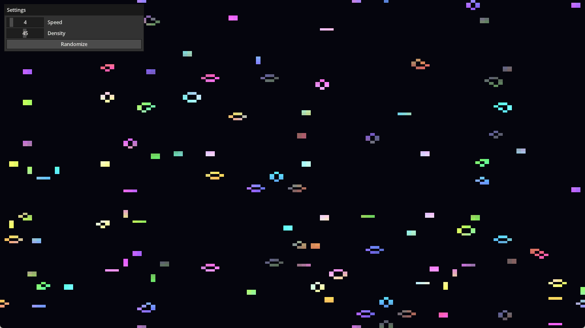

# Game of Life

Conway's Game of Life driven entirely on the GPU. A compute pass reads the
previous generation and writes the next into a second storage buffer; the two
buffers then swap roles every generation — a ping-pong. A render pass draws the
current generation as instanced quads. No readback, no CPU simulation.

## What this covers beyond `compute_shader`

- **Two storage buffers in one bind group**, one read-only source and one
  writable destination, swapped between dispatches.
- **Several dispatches per compute pass**, each with a different bind group, so
  one pass runs a batch of generations before the frame is drawn.
- Prebuilt bind groups per swap direction, instead of re-creating a group per
  generation.

As in `compute_shader`, the writable side is `.Storage` (compute only) and the
rendered side is `.Read_Only_Storage`, because a read/write storage buffer may
not be visible from the vertex stage without `Vertex_Writable_Storage`.

## Shader constants

The reference implementation makes the workgroup size a *pipeline constant*.
This backend accepts `Pipeline_Compilation_Options` in the descriptor but does
not forward it to `vkCreateComputePipelines`, so an override would be silently
ignored. The block size is therefore a plain `#define` in
`game_of_life.comp.slang`, mirrored by `BLOCK_SIZE` in the Odin source.

## Settings UI

A MicroUI overlay, wired the same way as `pristine_grid`:

| Control   | Effect                                                      |
| --------- | ----------------------------------------------------------- |
| Speed     | Generations simulated per rendered frame (1–32)              |
| Density   | Live-cell percentage of a fresh seed (1–90)                  |
| Randomize | Reseeds the grid and restarts from generation zero           |

Density only takes effect on Randomize, since it describes a seed; Speed applies
to the next frame.

## Tuning

`GENERATIONS_PER_FRAME` (4) is the starting value for the Speed slider. One step
per frame is accurate but reads as a slow crawl; the grid settles into still
lifes, blinkers and beehives within a few seconds.

## Running

```shell
build.bat|sh game_of_life run
```

## Screenshot



## Ref

- https://github.com/samdauwe/webgpu-native-examples/blob/master/src/examples/game_of_life.c
- https://webgpu/webgpu-samples/tree/main/src/sample/gameOfLife
