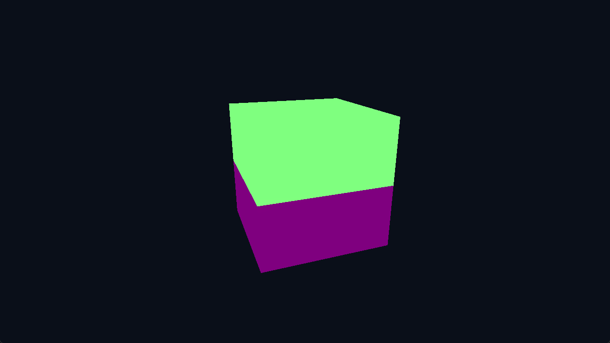

# glTF Cube

Loads the first mesh primitive from a small glTF 2.0 asset through the
framework's pure-Odin glTF helper and renders its POSITION/NORMAL attributes
and indices. Materials and scene-node transforms are intentionally kept out
of this first loader example.

## Running

```shell
build.bat|sh gltf_cube run
```

## Screenshot


