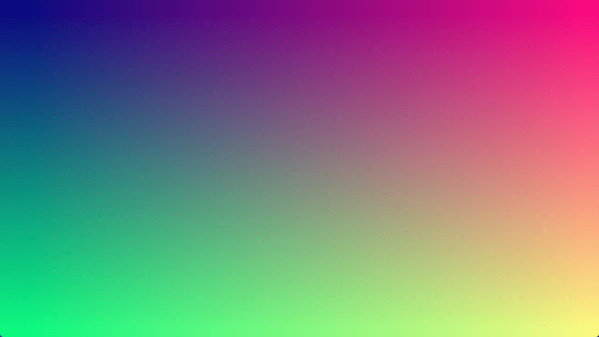

# Minimal

Minimalistic render pipeline demonstrating how to render a full-screen
colored quad.

Ref: 

- https://github.com/Palats/webgpu/blob/main/demos/demos/minimal.ts

## Running

```shell
build.bat|sh minimal run
```

## Screenshot


