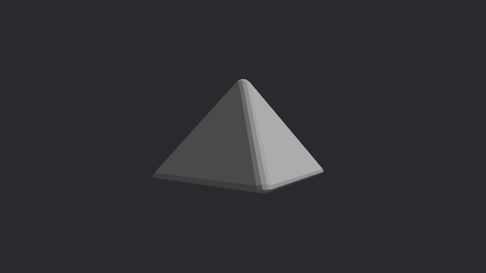

# OBJ Model

Loads a Wavefront OBJ model through the `tobj` utility package and renders it
with per-vertex normals and colors. The camera is a framework orbit camera: drag
to orbit, wheel to zoom.

## Running

```shell
build.bat|sh obj_model run
```

## Screenshot


