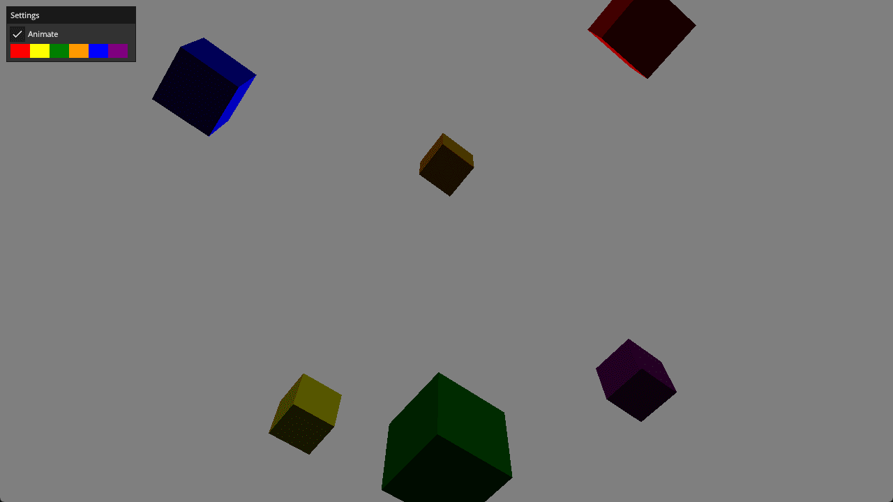

# Occlusion Query

Six coloured cubes sit on the cardinal axes around a common centre, and the camera
orbits them. Each cube is drawn inside its own occlusion query, and the resolved
fragment counts are read back to report which cubes are actually visible.

An occlusion query counts the fragments that pass the depth test, so a cube hidden
behind another reports **0** even though it was submitted. That is the building
block for GPU-driven visibility culling: a real renderer would use the previous
frame's counts to skip submitting the occluded geometry.

## What this covers beyond `timestamp_query`

`timestamp_query` measures a whole render pass from outside it. This example scopes
a query *inside* a pass, around a single draw:

- `device_create_query_set` with `Query_Type.Occlusion`
- `Render_Pass_Descriptor.occlusion_query_set`
- `render_pass_begin_occlusion_query` / `render_pass_end_occlusion_query`
- `command_encoder_resolve_query_set` + map, to read the counts back

Occlusion queries are core WebGPU, unlike timestamps — there is no feature to
request, so this example runs on any device.

## Reading the result

The counts are resolved and read back in the frame that wrote them, so the panel
shows the **previous** frame's results.

The readout is a row of colour swatches, one per **visible** cube, in that cube's
colour. When a cube reports no fragments its swatch simply disappears and the
remaining swatches pack left, touching with no gaps — matching the reference
sample's visible-id list. The panel keeps a fixed width sized for all six, so it
does not resize as cubes come and go.

Cube colours match the reference sample: red `+X`, yellow `−X`, green `−Y`,
orange `+Y`, blue `−Z`, purple `+Z`.

## Animation

The camera follows the reference sample: it rotates about X by `time`, about Y by
`0.7 * time`, and dollies between 5 and 40 units. The dolly matters — up close
the cubes behind the eye are outside the frustum, so only some are on screen;
pulling back brings all six into frame.

`ANIMATION_SPEED` (0.7) scales every animated quantity, so the whole move runs
somewhat slower than the reference without altering its shape.

The field of view is 45° rather than the reference's 30°, which otherwise crops
the cubes nearest the viewport edge at the far end of the dolly. Occlusion is
depth-based, so the wider angle does not change which cubes occlude each other.

## Running

```shell
build.bat|sh occlusion_query run
```

## Screenshot



## Ref

- https://webgpu/webgpu-samples/tree/main/src/sample/occlusionQuery
