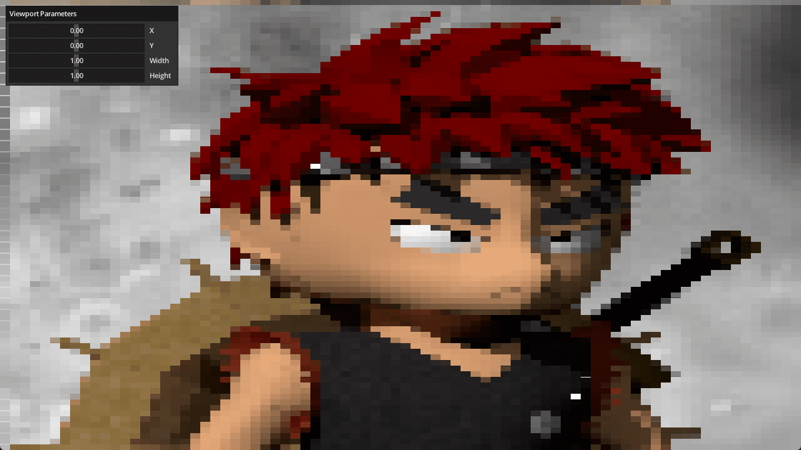

# Out-of-bounds Viewport

The spec doesn't let you set the viewport's values to be out-of-bounds.
Therefore, the viewport's values need to be clamped to the screen-size, which
means the viewport values can't be defined in a way that makes the viewport
go off the screen. This example shows how to render a viewport out-of-bounds.

Ref:

- https://github.com/samdauwe/webgpu-native-examples/blob/master/src/examples/out_of_bounds_viewport.c
- https://babylonjs.medium.com/how-to-simulate-out-of-bounds-viewports-when-using-webgpu-or-babylonnative-2280637c0660

## Running

```shell
build.bat|sh out_of_bounds_viewport run
```

## Screenshot


