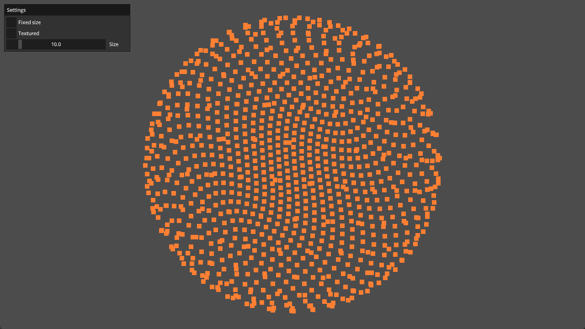

# Points

This example shows how to render points of various sizes using a quad and
instancing.

Ref:

- https://github.com/samdauwe/webgpu-native-examples/blob/master/src/examples/points.c
- https://github.com/webgpu/webgpu-samples/tree/main/sample/points
- https://webgpufundamentals.org/webgpu/lessons/webgpu-points.html

## Running

```shell
build.bat|sh points run
```

## Screenshot


