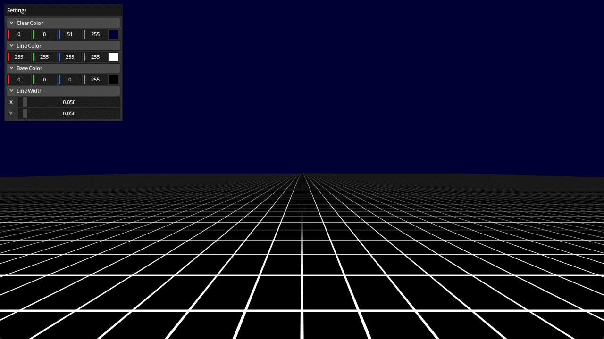

# Pristine Grid

A simple WebGPU implementation of the "Pristine Grid" technique described in
this wonderful little blog post:

https://bgolus.medium.com/the-best-darn-grid-shader-yet-727f9278b9d8

Ref:

- https://github.com/toji/pristine-grid-webgpu
- https://bgolus.medium.com/the-best-darn-grid-shader-yet-727f9278b9d8

## Running

```shell
build.bat|sh pristine_grid run
```

## Screenshot


