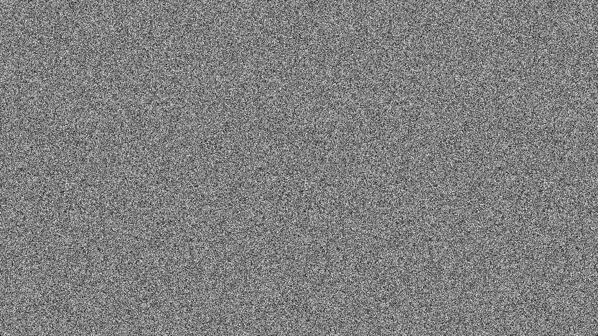

# Pseudorandom Number Generation

An example demonstrating pseudorandom number generation on the GPU. A
32-bit PCG hash is used which is fast enough to be useful for real-time,
while also being high-quality enough for almost any graphics use-case.

A pseudorandom number generator (PRNG), also known as a deterministic random
bit generator (DRBG), is an algorithm for generating a sequence of numbers
whose properties approximate the properties of sequences of random numbers.

Ref:

- https://github.com/samdauwe/webgpu-native-examples/blob/master/src/examples/prng.c
- https://en.wikipedia.org/wiki/Pseudorandom_number_generator
- https://github.com/wwwtyro/webgpu-prng-example
- https://www.reedbeta.com/blog/hash-functions-for-gpu-rendering/

## Running

```shell
build.bat|sh prng run
```

## Screenshot


