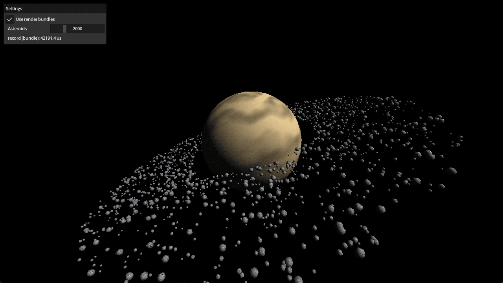

# Render Bundles

A ring of asteroids orbiting a planet, drawn one draw call at a time. That is
deliberately wasteful — instancing would collapse the whole ring into a single
call — because the point is to show the cost of issuing thousands of commands,
and then let you toggle a cheaper way of issuing them.

A render bundle is a sequence of draw commands recorded once and replayed many
times. This scene can be drawn either way: recorded once into a bundle and
replayed each frame, or recorded directly every frame. Nothing changes on
screen; the overlay reports the CPU time each path spends recording.

Because a bundle is fixed once finished, anything that changes what is drawn
needs a new one — moving the asteroid slider does exactly that. Work where the
draw list changes every frame, like culling, gains nothing for the same reason.

## Running

```shell
build.bat|sh render_bundles run
```

## Screenshot


