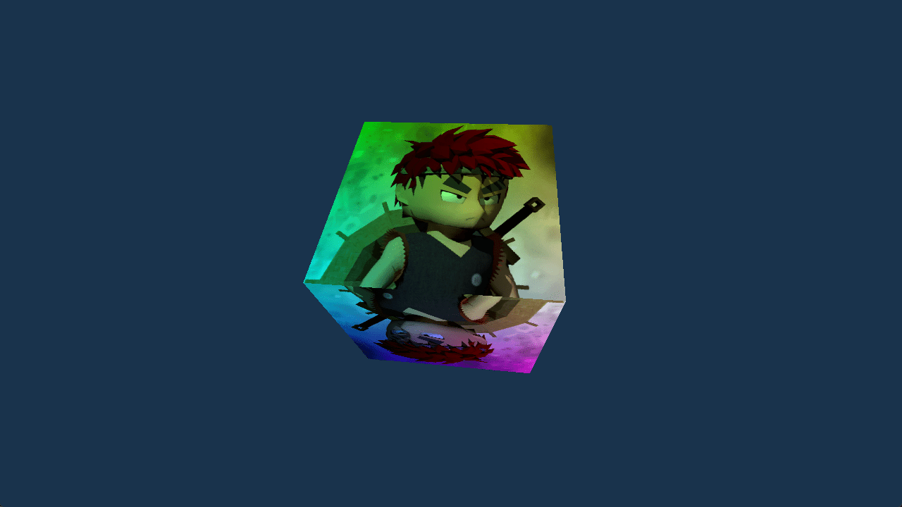

# Rotating Cube

This example shows how to bind and sample textures.

Ref:

- https://github.com/samdauwe/webgpu-native-examples/blob/master/src/examples/textured_cube.c
- https://github.com/webgpu/webgpu-samples/tree/main/sample/texturedCube
- https://github.com/gfx-rs/wgpu-rs/tree/master/examples/cube

## Running

```shell
build.bat|sh rotating_cube run
```

## Screenshot


