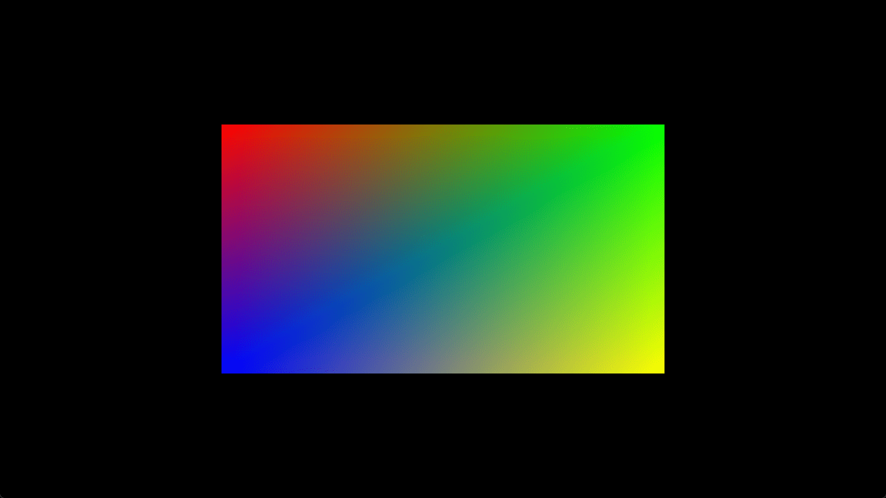

# Square

This example shows how to render a static colored square with only using
vertex buffers.

Ref:

- https://github.com/cx20/webgpu-test/tree/master/examples/webgpu_wgsl/square
- https://github.com/samdauwe/webgpu-native-examples/blob/master/src/examples/square.c

## Running

```shell
build.bat|sh square run
```

## Screenshot


