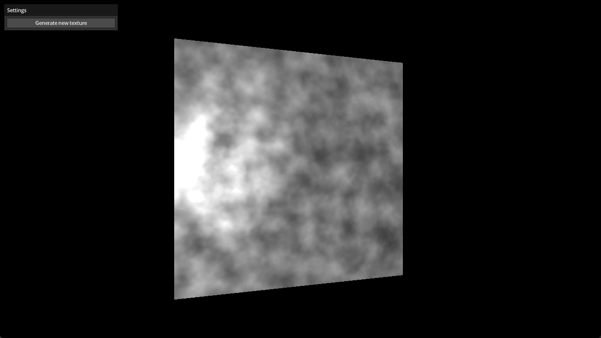

# 3D Texture

Demonstrates 3D texture loading and generation using Perlin noise. A 3D noise
texture is procedurally generated on the CPU using fractal Perlin noise and
uploaded to the GPU as a 3D texture. The depth slice through the volume is
animated over time, showing a smoothly changing cross-section of the noise field
rendered on a lit quad.

Features:

- Procedural 3D Perlin noise generation (fractal noise with 6 octaves)
- 3D texture creation and upload (R8Unorm, 128x128x128)
- Animated depth slice through the 3D volume
- Phong lighting (diffuse + specular)
- GUI button to regenerate the noise texture
- Camera interaction (LookAt orbit) via mouse

Ref:

- https://github.com/SaschaWillems/Vulkan/blob/master/examples/texture3d
- https://github.com/samdauwe/webgpu-native-examples/blob/master/src/examples/texture_3d.c

## Running

```shell
build.bat|sh texture_3d run
```

## Screenshot


