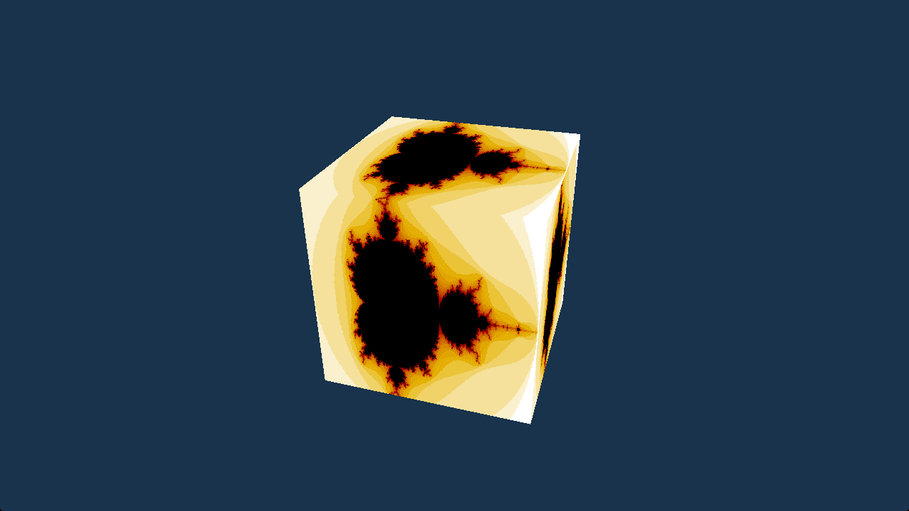

# Textured Cube

This example shows how to generate a texture on the GPU (a Mandelbrot
fractal, rendered into an R8_Unorm texture) and sample it onto a cube,
using a false-color gradient to visualize escape-time values.

Ref:

- https://github.com/gfx-rs/wgpu/tree/trunk/examples/features/src/cube

## Running

```shell
build.bat|sh textured_cube run
```

## Screenshot


