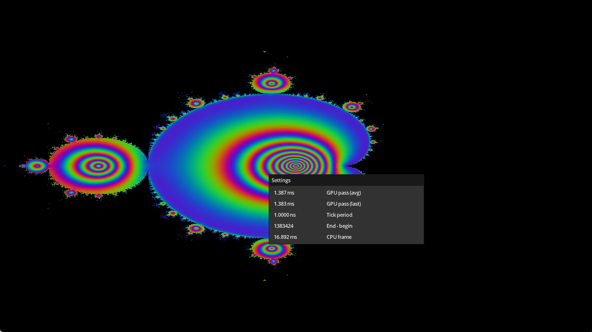

# Timestamp Query

Measures GPU frame time with timestamp queries. The render pass writes a
timestamp at its start and end, the encoder resolves the pair into a buffer, and
the CPU reads it back to display the elapsed GPU milliseconds.

This is the first example to use `Query_Set` at all, and it covers the whole
lifecycle that nothing else exercises:

- `device_create_query_set` for a timestamp set
- `Render_Pass_Timestamp_Writes` on the render pass descriptor
- `command_encoder_resolve_query_set` into a `Query_Resolve` buffer
- mapping that buffer back and scaling raw ticks by the queue's timestamp period

The measured pass is a deliberately expensive 64-iteration Mandelbrot per pixel,
so there is real GPU work to report rather than a clear colour.

## Tick period

Timestamps are raw GPU ticks unless the instance enables
`Automatic_Timestamp_Normalization`, which is off by default because it injects
a compute shader into the resolve. This example does not enable it, so it scales
by `queue_get_timestamp_period()`, shown in the UI. On this machine the period is
1.0 ns, so ticks and nanoseconds coincide; that is not true on all hardware.

## Reading the result

The resolve and readback happen in the frame that *wrote* the timestamps, so the
value shown is one frame behind. Both the last sample and a rolling average over
20 frames are displayed, alongside the raw `End - begin` tick delta so the
millisecond figure can be checked against it. The CPU frame time is shown for
comparison — the GPU pass should be a fraction of it at this workload.

WebGPU leaves the timestamp *origin* implementation-defined, and the two slots
are only meaningful as a **difference**. Chrome returns nanoseconds since the
epoch (~1.8e18), so:

- The subtraction is done in `u64` before any float conversion. An unsigned
  subtraction that wraps, or an `f32` accumulator at that magnitude, both turn a
  real frame time into a number like `1.8e12 ms`.
- The pair is checked for order first. A delta above one second is treated as
  "a slot was not written" and the UI shows `no data` rather than a zero that
  reads like a real measurement.
- `Begin ticks` / `End ticks` are shown in hex: a 20-digit decimal does not fit
  the label buffer, and hex makes a zero or truncated slot obvious.

Nothing is measured when the device lacks `Timestamp_Query`: the example requests
it via `main`, but if the adapter does not advertise it the UI says so and no
query resources are created.

## Backend bugs this example found

Three, all pre-existing and invisible until something actually resolved a query
set (also absent upstream):

1. **Timestamp slots were never reset.** `vkCmdWriteTimestamp` requires the query
   to be unavailable, and nothing reset it. Fixed by resetting the slot inline,
   immediately before the write, as Dawn does — resetting a run of slots ahead of
   a pass also wiped slots written by earlier buffers in the same submission.
2. **`Query_Resolve` had no barrier mapping.** `vk_conv_buffer_uses_to_barrier`
   had no case for it, so a resolve then copy raced: `SYNC-HAZARD-READ-AFTER-WRITE`.
3. **`resolve_query_set` never flushed its pending transition.** It tracked the
   destination usage but left the barrier pending, unlike `copy_buffer_to_buffer`.

## Running

```shell
build.bat|sh timestamp_query run
```

## Screenshot



## Ref

- https://github.com/samdauwe/webgpu-native-examples/blob/master/src/examples/timestamp_query.c
- https://webgpu/webgpu-samples/tree/main/src/sample/timestampQuery
