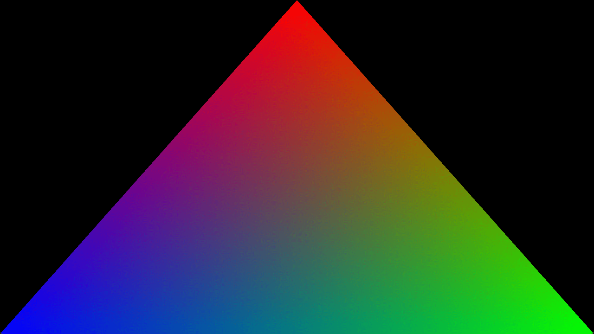

# Hello Triangle

This example shows rendering a basic triangle using a vertex buffer that
holds positions and colors.

Ref: 

- https://github.com/webgpu/webgpu-samples/tree/main/sample/helloTriangle

## Running

```shell
build.bat|sh triangle run
```

## Screenshot


