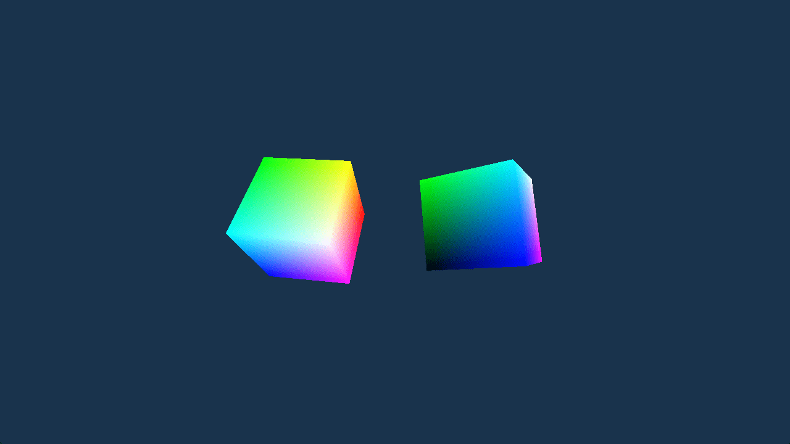

# Two Cubes

This example shows some of the alignment requirements involved when updating
and binding multiple slices of a uniform buffer. It renders two rotating
cubes which have transform matrices at different offsets in a uniform buffer.

Ref:

- https://github.com/samdauwe/webgpu-native-examples/blob/master/src/examples/two_cubes.c
- https://github.com/webgpu/webgpu-samples/tree/main/sample/twoCubes

## Running

```shell
build.bat|sh two_cubes run
```

## Screenshot


