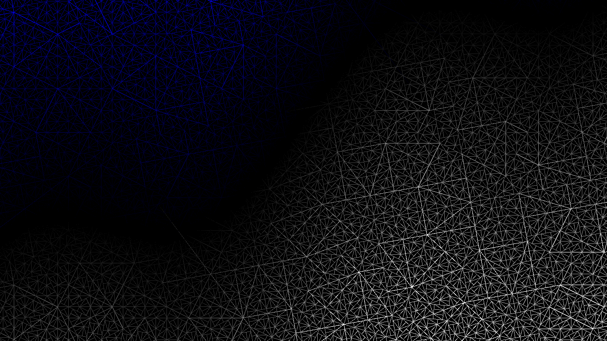

# Vertex Buffer

Generates procedural triangle geometry with subdivision and renders it using
a vertex buffer. Shows how to create and upload vertex data to the GPU.

## Running

```shell
build.bat|sh vertex_buffer run
```

## Screenshot


